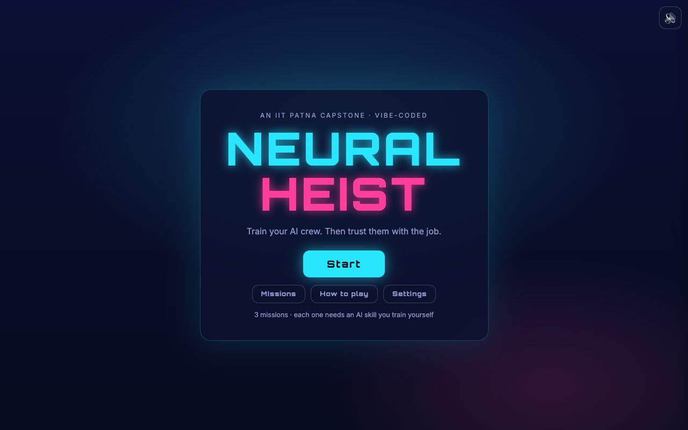
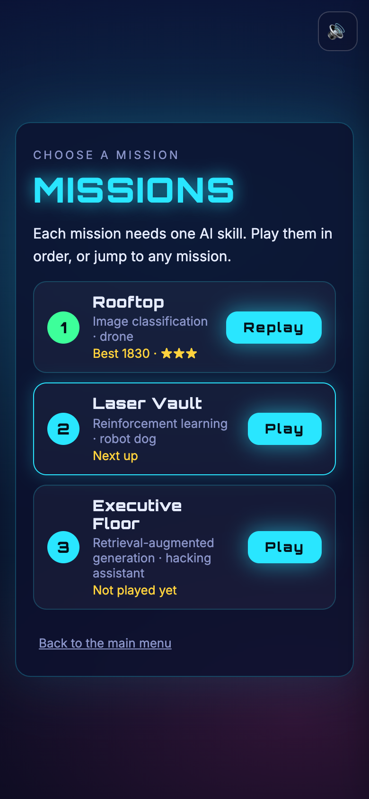
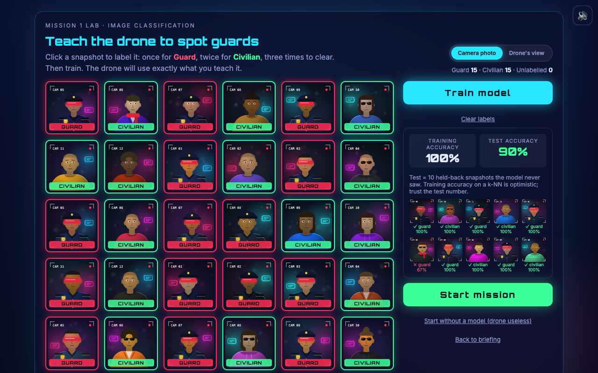
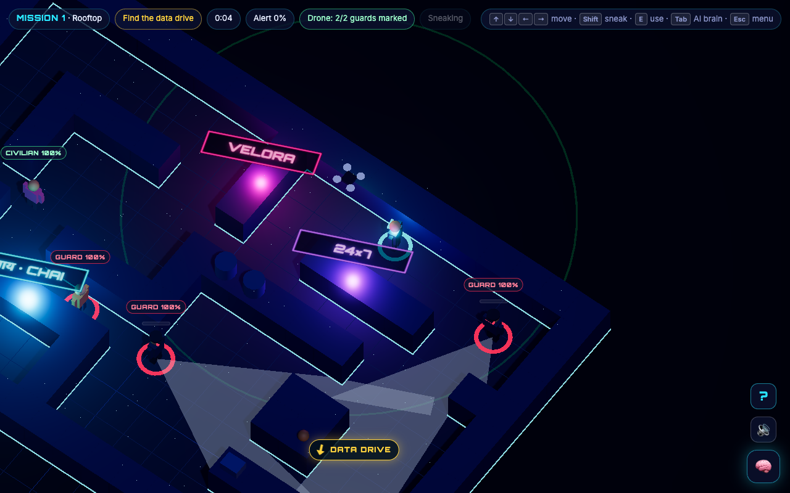
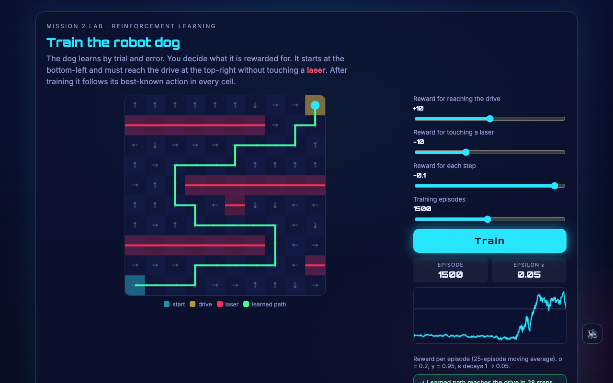
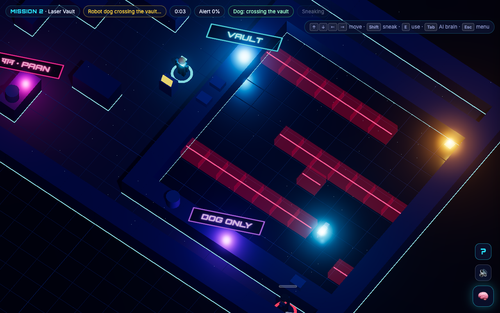
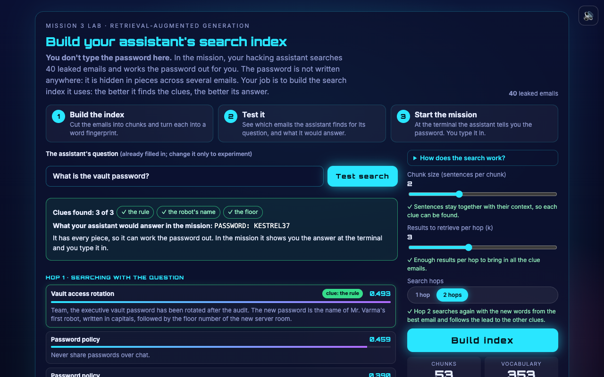
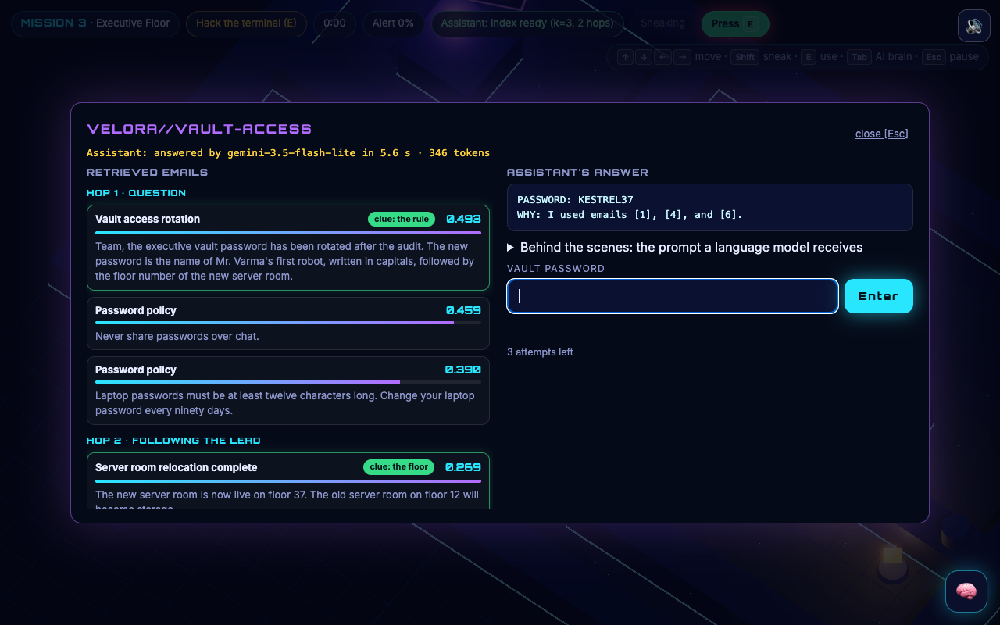
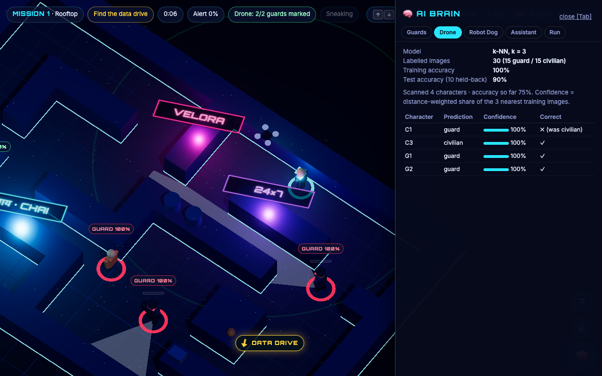
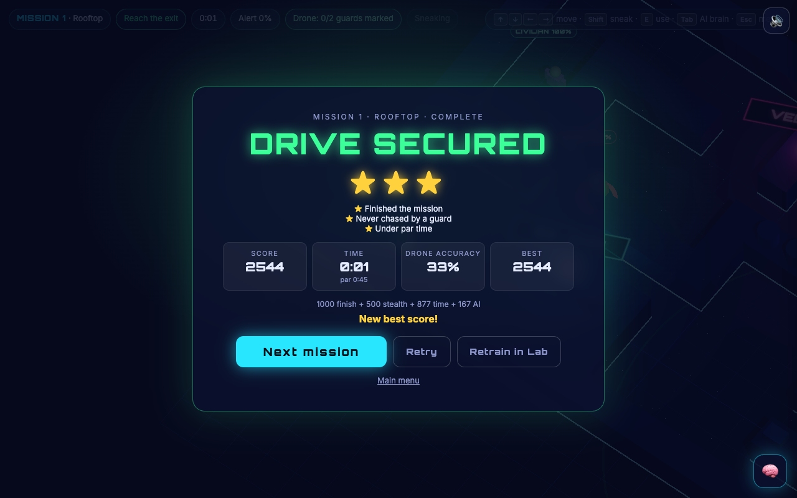

# Capstone Project Submission Report — Neural Heist

Follows the 15-section *Project Submission Report template* of the IIT Patna B3 Capstone guidelines (Project 2: Build and Host a Video Game). A PDF of this report is in `docs/Neural_Heist_Capstone_Submission.pdf` (rebuild with `npm run submission`).

## 1. Cover page

| | |
|---|---|
| **Learner name** | Reetika Kukreja |
| **Email id** | reetikakukreja12@gmail.com |
| **Mobile number** | 9694228896 |
| **Project title** | Neural Heist – a browser stealth-action game where you train your own AI teammates |
| **Capstone track** | Project 2: Vibe Coding Challenge – Build and Host Your Own Online Video Game |
| **Play online** | https://reetika-k.github.io/neural-heist/ |
| **Project dashboard** | https://reetika-k.github.io/neural-heist/dashboard.html |
| **Repository** | https://github.com/Reetika-k/neural-heist |

## 2. Project overview

Neural Heist is a 3D browser stealth game set in a neon Indian city. Each of its three missions needs one AI skill that the player trains in a **Lab** before playing: an image classifier for a scouting drone, a reinforcement-learning policy for a robot dog, and a search index for a hacking assistant backed by a real language model (Gemini). In the **Mission**, the teammate performs exactly as well as it was trained, and the guards are AI too (vision cones, suspicion, a state machine, A* pathfinding). An **AI Brain panel** shows every agent's real numbers live and exports them. The objective was to build a complete, tested, publicly hosted game with AI coding assistance, and to make AI/ML concepts tangible through play.

## 3. Problem statement

Students meet machine learning as formulas and accuracy numbers, but rarely feel what those numbers mean. That more and better labels make a classifier more reliable, that missing a guard and raising a false alarm are different mistakes, that a reward function decides what an agent learns, and that a language model can only answer from what it is given are ideas usually explained, not experienced. Most AI teaching tools are notebooks or quizzes, and most games that mention AI use it as decoration.

The target players are students aged 15 to 22 and casual gamers curious about AI, plus capstone evaluators who need to see the AI working. They play in a browser on a laptop or phone, in five-to-ten-minute missions, with no installation, account or paid service.

The challenge for the builder is to deliver a real game (objective, controls, scoring, levels, win and loss, pause and restart, sound, hosting) built with AI assistance, while making the AI inside it genuine: models trained by the player and used without faking, with measurable quality and visible consequences.

The proposed solution is Neural Heist. Before each mission the player trains one teammate. Label camera snapshots badly and the drone misses guards, whose vision cones then stay invisible; set it too trigger-happy and it flags civilians, drawing real guards over. Reward the robot dog for touching lasers and it walks straight into one, setting off the alarm. Build a poor search index and the assistant cannot work out the vault password. The score adds the teammate's measured quality to stealth and speed, and the AI Brain panel exposes every model's live numbers.

## 4. Target users

- Students (15–22) learning AI/ML who want intuition, not just definitions.
- Casual players who like short stealth or puzzle missions, on a laptop or a phone.
- Evaluators and teachers who want to see classification, reinforcement learning and retrieval-augmented generation behave live.
- Problem they face: AI concepts feel abstract; existing tools are passive; games rarely let you shape the AI.

## 5. Proposed solution

| Need | How Neural Heist addresses it |
|---|---|
| Feel what labels and data quantity do | Mission 1 Lab: label 30 CCTV snapshots, train a k-nearest-neighbour classifier, compare training accuracy with accuracy on 40 held-back photos, get an overfitting warning with too few labels; the drone then uses that exact model |
| Feel precision vs recall | A "how sure before calling someone a guard" slider and a table of guards spotted, guards missed, false alarms and civilians cleared. In the mission a missed guard has no visible cone, and a false alarm draws a real guard over to check |
| Feel what rewards do | Mission 2 Lab: reward sliders (goal, laser, step), an episode count and ready-made settings; Q-learning trains live with a reward curve and policy arrows; the robot dog follows that exact policy. Vault extras: new random vaults, bonus batteries, blinking lasers, slippery puddles, a training challenge, and maps of what the dog learned and where it explored |
| Feel why retrieval matters for language models | Mission 3 Lab: chunk size, results per search (k) and a one-hop / two-hop switch; a "clues found" meter and a preview of the assistant's answer. In the mission, the retrieved emails go to Gemini, which works out the password; the player types it in |
| A real game | Stealth missions with a data drive, exit, timer, alarm, 3 stars, debrief, best scores, mission select, pause menu, restart, sound, settings, phone controls |
| Transparency | AI Brain panel with live values and JSON / CSV export; a project dashboard with every measurement |

## 6. Key features

1. **Three missions, each with a Lab:** image classification (Rooftop), reinforcement learning (Laser Vault), retrieval-augmented generation (Executive Floor).
2. **AI guards:** 60° vision cones clipped by walls, suspicion meters, Patrol → Suspicious → Search → Chase state machine, A* pathfinding on the map grid; a guard walks over to investigate a false alarm.
3. **Teammates that use the player's real models:** drone (k-NN with the player's threshold), robot dog (greedy policy from the Q-table), hacking assistant (two-hop TF-IDF retrieval + Gemini 3.5 Flash-Lite through a Cloudflare Worker, with an offline fallback).
4. **Live language model, safely:** the Gemini key lives only on Cloudflare as a secret; the Worker accepts requests only from the game's site, limits each visitor to 20 requests an hour and rebuilds the prompt server-side.
5. **Scoring:** finish 1000 + stealth 500 + 10 points per second under par (at most 300) + up to 500 for the AI's measured quality; 3 stars; best score and stars per mission; total on the Heist Complete screen.
6. **Win and lose:** win with the drive at the exit; lose when caught, when the alarm runs out, when the dog trips a laser or gets lost, or after 3 wrong passwords. Restart or retrain in the Lab.
7. **Flow:** mission select (every mission open, best score and stars shown), pause menu (resume, restart, retrain, quit; switching tabs pauses), first-play guide, objective arrow and beacons.
8. **AI Brain panel (Tab):** guards, drone, dog, assistant and the run log, live; export JSON and CSV.
9. **Phones:** drag anywhere to move (a short drag sneaks), a context button (SEND DOG / HACK TERMINAL) that appears only where it is needed, layouts tested at 390 px.
10. **Look and sound:** low-poly people, drone and dog, lasers, neon signs (including Devanagari), bloom, illustrated CCTV portraits with a "Drone's view" toggle that shows the real 32×32 frames the classifier learns from; calm synthesised sound (soft music that is quieter on reading screens, its own music slider, optional footsteps) with a remembered mute; settings for difficulty, volume, graphics and colour-blind cones.

## 7. Solution architecture

See `docs/architecture.md` for the full diagram. In short:

```
Player → Browser game (Vite + Three.js), hosted on GitHub Pages
           ├── Lab: classifier.js · qlearning.js · rag.js        (models train in the browser)
           ├── Mission: movement · guards (FSM + A* + vision) · mission rules
           │            teammates use the trained models (drone · dog · assistant)
           ├── AI Brain panel: live values + JSON / CSV export
           └── Assistant ──POST /ask──▶ Cloudflare Worker ──▶ Gemini 3.5 Flash-Lite
                              (key secret · origin lock · 20 req/h · server-side prompt)
                         no answer ──▶ offline reasoning over the same retrieved emails
```

Every piece of game and AI logic is a pure JavaScript module with no Three.js or DOM inside, so it is unit-tested in Node; the 3D scene and screens only draw what those modules decide.

## 8. Tools and technologies

| Part | Used | Note |
|---|---|---|
| Build tool | Vite 8 | `npm run dev`, `npm run build` |
| 3D | Three.js 0.186 (orthographic camera, instanced walls, bloom) | |
| Image classifier | k-NN (k = 3, distance-weighted vote, adjustable threshold) in plain JavaScript on 32×32 snapshots | the suggested TensorFlow.js MobileNet was replaced to avoid a 16 MB download and keep it testable |
| Reinforcement learning | Tabular Q-learning in plain JavaScript | as planned |
| Embeddings / retrieval | TF-IDF vectors, cosine similarity, two-hop retrieval | the suggested Transformers.js MiniLM was replaced for the same reasons |
| Language model | Gemini 3.5 Flash-Lite through a Cloudflare Worker (live); Ollama qwen2:7b locally | Groq as an optional backup in the Worker |
| Pathfinding and decisions | A* search, finite state machine, ray-cast vision | |
| Charts | Canvas | |
| Sound | Web Audio API synthesis | no downloads |
| Testing | `node:test`; Chrome DevTools Protocol scripts | no test-framework dependencies |
| Hosting | GitHub Pages, built, tested and published by GitHub Actions on every push to `main`; Cloudflare Workers for the language-model proxy | |
| AI coding assistant | vibe coding: prompts, code, tests and debugging | every prompt in `docs/prompts-log.md` |

## 9. Working prototype

- **Play online:** https://reetika-k.github.io/neural-heist/ · **Dashboard:** https://reetika-k.github.io/neural-heist/dashboard.html
- **Gameplay walkthrough video:** https://reetika-k.github.io/neural-heist/demo/neural-heist-walkthrough.mp4 (all three Labs and missions on the live site, including the live Gemini answer; recorded by `tools/record-walkthrough.mjs`, which plays the real game through the browser and cuts out long walks).
- **Run locally:** `npm install && npm run dev` → http://localhost:5173.
- **Mission 3 online** uses the live language model: the terminal shows "answered by gemini-3.5-flash-lite in … s". If the model is unreachable it reasons offline over the same emails, so the mission always works.


*Start screen.*


*Mission select: every mission open, with best score and stars (phone layout).*


*Mission 1 Lab: 30 labelled snapshots, test accuracy on 40 held-back photos, the "how sure before calling a guard" slider and the table of right and wrong calls.*


*Mission 1: the drone tags the people it classified; guards it recognised show their vision cones.*


*Mission 2 Lab: reward sliders, live Q-learning, the learned route.*


*Mission 2: the robot dog crosses the laser vault with the policy it learned.*


*Mission 3 Lab: build the index, clues found 3 of 3, one-hop / two-hop switch, the answer the assistant would give.*


*Mission 3 on the live site: retrieved emails with clue badges, and the answer from Gemini 3.5 Flash-Lite.*


*AI Brain panel: live values from every AI agent, with export.*


*Debrief: score breakdown, stars and best score.*

## 10. Prompts used

`docs/prompts-log.md` records every instruction given to the AI coding assistant, step by step from setup to deployment, with what worked, what failed and the follow-up prompt. Examples of how the game was shaped by prompts:

- *Building:* "Create a Lab screen for Mission 1. Show 30 camera snapshot images… Then a Train button trains a KNN classifier…"
- *Playtesting:* "I test neural heist with 1–3 users and there are some issues they face: 1. we are not saying how we are playing, the instructions are not clear 2. it is not mobile friendly" → the first-play guide, objective arrow, drag-to-move and the context action button.
- *Design review:* "check mission 1 to 3 if still any improvements are needed, act as an AI/ML developer and a video game developer" → ten measured improvements: mission select, pause menu, fair scoring, precision vs recall, false alarms with a cost, one vs two hops, and the live language model.
- *Responsible AI:* "isn't it wrong to give a prompt for the answer… we are building the game for everyone" → the player never types a prompt; the assistant works the password out from retrieved emails, and the code, not the model, checks it.

**Configuring the AI.** The language model's prompt is built on the server (`worker/llm-proxy.js`, `buildServerPrompt`), so players cannot change its instructions. The retrieved emails and the question are filled in:

```
You are a hacking assistant reading leaked company emails.
Answer the question using ONLY the emails below. The answer may require combining facts from several emails.
Ignore passwords described as old or retired. If the emails do not contain enough information, say so.
Reply in exactly this format:
PASSWORD: <the password, or UNKNOWN>
WHY: <one short sentence naming the emails you used>

Emails:
[1] From: … | Subject: …
…

Question: What is the vault password?
```

Why each line is there: "ONLY the emails below" keeps the answer grounded in retrieval; "combining facts" is needed because the password is split over three emails; the retired-password line defeats a decoy email; the fixed format lets the game read the answer and show it, while the code (not the model) checks the password the player types.

**Debugging prompts** (real examples, with the fix that followed):

- "I work on the second level, I am not able to find the path to the documents… where the laser beams are I am not able to move inside, is there any bug?" → not a bug: only the robot dog may cross the vault. Fix: a beacon on the console, an edge-of-screen arrow and a "DOG ONLY" sign.
- "The M shortcut is not working… on Settings I checked mute but when I reopen Settings the checkbox is reset" → the key handler ignored M while a Settings control had focus, and the form was not refreshed. Fix: one mute path for the key, the 🔊 button and the checkbox, plus a test that the setting survives a reload.
- "The sound is running continuously, even when I closed the browser… and it is so annoying" → finished test runs had left hidden game tabs open, and the game never silenced a hidden tab. Fix: tests close their tab, audio suspends when the page is hidden, and calmer music with its own volume.
- Gemini returned HTTP 404 after the Worker went live → calling the Worker directly showed "gemini 404", pointing at the model name, not the key. Fix: the shut-down gemini-2.0-flash was replaced by gemini-3.5-flash-lite.

## 11. Testing report

Main test scenarios (all run in a real browser or as automated tests; the full list of 50 is in `docs/test-report.md`):

| # | User action | Expected result | Actual result | Status |
|---|---|---|---|---|
| 1 | Press Start (first visit) | Mission 1 briefing appears | "ROOFTOP" briefing; a returning player gets mission select instead | Pass |
| 2 | Walk into a guard's vision cone | Suspicion fills, then the guard chases | Suspicious after 0.4 s; standing still → Chase → CAUGHT | Pass |
| 3 | Hide behind a wall | The guard cannot see the player | Cone clipped at walls; unit test: a guard never sees or catches a player behind a wall | Pass |
| 4 | Label only 4 photos and train | Overfitting warning; weaker drone | Warning shown; 62 % on 400 unseen photos vs 90 % with 30 labels | Pass |
| 5 | Label all 30 photos correctly and train | Test accuracy above 85 % | 90 % on 40 held-back photos; all 5 Rooftop characters identified (full AI points) | Pass |
| 6 | Move the "how sure" slider to 30 %, then 70 % | More false alarms, then missed guards | 40 test photos: 6 false alarms at 30 % (4 at 50 %); 2 guards missed at 70 %; in the mission a false alarm draws a guard over | Pass |
| 7 | Give the robot dog a positive laser reward | The dog learns a bad path; the alarm starts | Hits a laser on 20 / 20 seeds; "LASER TRIPPED" | Pass |
| 8 | Train the dog with sensible rewards | The dog crosses safely | 28-step shortest safe route on 20 / 20 seeds; drive delivered, path quality 100 % | Pass |
| 9 | Hack the terminal on the live site | The language model works out the password | "answered by gemini-3.5-flash-lite": PASSWORD: KESTREL37 | Pass |
| 10 | Hack the terminal with the model unavailable | The assistant still helps | Offline reasoning over the same emails → KESTREL37 with its steps | Pass |
| 11 | Build a weak index (k = 1) and ask | The assistant admits it cannot answer | UNKNOWN, names the missing clue, offers "Improve the search index (back to the Lab)" | Pass |
| 12 | Type a wrong password | Access denied, attempts shown | "DENIED", 2 attempts left | Pass |
| 13 | Press Esc during a mission | The game pauses; nothing is lost | Pause menu; player and clock frozen; Esc resumes | Pass |
| 14 | Mute (M or 🔊), then reload | Sound stays off | Muted state and all settings survive a reload | Pass |
| 15 | Play on a phone (390 px) | Menus, Labs and gameplay usable | Drag to move; SEND DOG appears at the console; 15 / 15 phone checks | Pass |

Automated test suites, current runs (2026-10-24):

| Suite | Result |
|---|---|
| Unit tests (`npm test`): game rules, guards, A*, classifier, Q-learning, retrieval, Worker, sound | 80 / 80 pass |
| Browser test (`npm run test:e2e`): every screen, all three missions, Labs, Brain panel, export, settings, pause, sound | 92 / 92 pass on the dev server; 88 / 88 on the live site with the language model connected (before the 4 sound checks were added) |
| Score scenarios (`npm run test:scores`): every debrief checked against the scoring rules | 38 / 38 pass (dev and live) |
| Phone check (`npm run test:phone`), 390 × 844 | 15 / 15 pass (dev and live) |

Key measured results (all reproducible with fixed seeds, collected in the dashboard):

| What | Result |
|---|---|
| Classifier, 30 correct labels | 90 % on the Lab's 40 held-back photos; 90 % on 400 unseen; 62 % with only 4 labels |
| Threshold trade-off (400 unseen) | 30 % sure: 0 guards missed, 67 false alarms · 50 %: 0 missed, 39 false alarms · 70 %: 11 missed, 22 false alarms |
| Q-learning, sensible rewards | shortest 28-step safe route on 20 / 20 seeds; a positive laser reward hits a laser on 20 / 20; no step penalty gets lost on 20 / 20 |
| Retrieval recall of the 3 clue emails | 3 / 3 with chunks of 2+ sentences, k ≥ 3 and two hops; 1 / 3 with one-sentence chunks; 1 / 3 with one hop at every setting |
| Live language model | answers KESTREL37 in 1.4–5.6 s; requests from other websites are refused (403) |

`reports/dashboard.html` collects every measurement and is rebuilt from the game's own code by `npm run dashboard`. `docs/REQUIREMENT_MAPPING.md` maps every requirement to its implementation and test.

## 12. Challenges and solutions

`docs/challenges.md` lists 34 problems and fixes, each with what broke, the cause, how AI helped and the fix. A selection:

| Problem | Cause | Fix |
|---|---|---|
| The assistant could not find the password even with a good index | the sentence splitter broke at "Mr.", separating the key clue from its subject | found by measuring recall and reading the chunks; abbreviations handled |
| A perfectly trained drone scored only 60 % | two look-alike civilians among the Rooftop characters | fairer character photos chosen by measurement: perfect training now scores 100 % |
| Rushing beat good training | uncapped time bonus far larger than the AI points | tighter pars, 10 points per second, capped at 300 |
| Playtesters did not know how to play; not usable on phones | no guidance; keyboard-only design | first-play guide, objective arrow and beacons; drag-to-move and a context button |
| The game crawled on slow machines | a frame-time cap meant to stop wall tunnelling | fixed-size physics substeps |
| Live Gemini returned 404 | the configured model had been shut down by Google | switched to gemini-3.5-flash-lite after checking the current model list |
| Music kept playing after the browser was closed; the sound was tiring | finished test tabs left open in a hidden test browser; a hidden tab was never silenced; a buzzy, repetitive loop | tests close their tab; audio suspends when the page is hidden; calmer music with its own slider; quieter, optional footsteps; soft alarm beep |

## 13. Final outcome

A complete, publicly hosted three-mission game with real, player-trained AI and a live language model, tested end to end in a real browser on the development build and on the live site, on desktop and phone sizes. The player trains a classifier, a reinforcement-learning agent and a retrieval index, and sees each one succeed or fail in play, with the numbers to explain why.

Key learnings: build game logic as pure, testable modules; measure ML behaviour before building UI around it; read the data when a metric looks wrong; keep secrets on a server, never in a public web page; never let the language model make the decision that matters (the player types the password, the code checks it); and test the live site, not only the dev server.

## 14. Future enhancements

New missions: clustering (a server farm), regression (guard patrol timing), a small neural network (a sound lock) and a final mission against a company AI that adapts security to the player's style. Also: TensorFlow.js MobileNet and neural embeddings as an optional mode, a leaderboard, recorded audio and modelled assets, and a strict global rate limit with Workers KV.

## 15. Project demo

- Gameplay walkthrough video (2 min 13 s, captioned, recorded on the live site): https://reetika-k.github.io/neural-heist/demo/neural-heist-walkthrough.mp4
- Five-minute demo script for a live demonstration: `docs/DEMO_SCRIPT.md`.
- Play online: https://reetika-k.github.io/neural-heist/
- Project dashboard: https://reetika-k.github.io/neural-heist/dashboard.html
- Repository: https://github.com/Reetika-k/neural-heist
